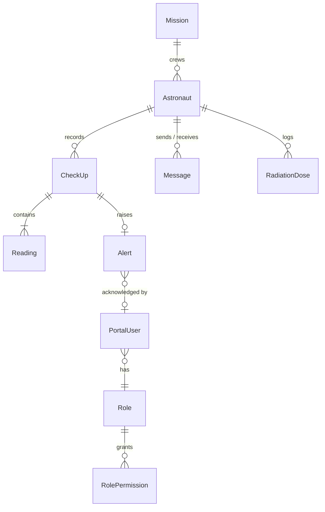

# Heartbeat — Data Model & API Contracts

Version 0.2 · Nov 15, 2026 · Hours 0–4 deliverable. 0.2 adds `Reading.Source` and `Reading.DeviceId` (smartwatch readiness, issue #9), radiation dose logging (issue #51), and the environment / radiation v2 / risk / phantom DTOs (issue #95, §10).

This file is the agreement every workstream builds against. Change it only by team agreement, and bump the version when you do.

- **Reference ranges and guidance:** [`reference-ranges.json`](reference-ranges.json) (MR-03, MR-04, MR-07)
- **Desktop app:** WPF (`net10.0-windows`), SQLite through EF Core
- **Backend:** one ASP.NET Core host, two route groups: `/api/crew/v1` and `/api/mc/v1`
- **Portal:** Blazor Web App that calls only `/api/mc/v1`

---

## 1. Conventions

| Topic | Rule |
| --- | --- |
| IDs | `Guid` (v7 via `Guid.CreateVersion7()`), generated **by whoever creates the record**. The desktop creates check-up, reading and message IDs offline, so a sync can be retried safely. |
| Time | UTC everywhere, sent as ISO-8601 `DateTimeOffset` (`2026-11-14T09:30:00Z`). The UI converts to local time or mission elapsed time. |
| JSON | camelCase; enums as camelCase strings (`"critical"`, not `2`). |
| Decimals | `decimal` in C#; JSON numbers. |
| Errors | RFC 7807 `ProblemDetails`. Validation errors use `ValidationProblemDetails` with `errors` per field. |
| Paging | `?page=1&pageSize=50` → `{ "items": [...], "page": 1, "pageSize": 50, "total": 312 }` |
| Auth | `Authorization: Bearer <jwt>`. Crew and MC tokens have different audiences and are not accepted by the other API. |
| Status codes | 200 read/update, 201 create, 204 no body, 400 validation, 401 no/invalid token, 403 missing permission, 404 not found or not yours, 409 conflict. |

---

## 2. Shared library (`Heartbeat.Shared`)

Used by the backend **and** the desktop app, so offline results match server results exactly.

```csharp
namespace Heartbeat.Shared;

public enum IndicatorType { BloodPressure, HeartRate, BloodSugar, BodyTemperature, Sleep, Mood }
public enum HealthStatus  { Normal = 0, Watch = 1, Critical = 2 }   // order matters: worst = max
public enum Hazard        { SpaceRadiation, IsolationAndConfinement, DistanceFromEarth, GravityFields, HostileClosedEnvironment }
public enum EscalationContact { Self, CrewMedicalOfficer }
public enum ReadingSource { Manual, Wearable }                        // where a reading came from

// What the astronaut enters. BloodPressure: Value = systolic, SecondaryValue = diastolic.
public sealed record ReadingInput(IndicatorType Indicator, decimal Value, decimal? SecondaryValue = null);

public sealed record ReadingEvaluation(
    IndicatorType Indicator,
    HealthStatus Status,
    IReadOnlyList<string> BandIds,        // e.g. ["bp-sys-watch-high", "bp-dia-normal"]
    string Label,                         // label of the worst band
    IReadOnlyList<string> Guidance,       // guidance of the worst band(s), de-duplicated
    Escalation? Escalation,               // null when Normal
    IReadOnlyList<SourceLink> Sources);

public sealed record Escalation(EscalationContact Contact, string Message);
public sealed record SourceLink(string Title, Uri Url);

public sealed record CheckUpEvaluation(
    HealthStatus OverallStatus,           // worst of all readings
    IReadOnlyList<ReadingEvaluation> Readings,
    string RangesVersion);

public interface IHealthEvaluator
{
    string RangesVersion { get; }
    ReadingEvaluation Evaluate(ReadingInput input);
    CheckUpEvaluation Evaluate(IEnumerable<ReadingInput> inputs);
    IReadOnlyList<string> Validate(ReadingInput input);   // empty = valid; uses validRange
}
```

### Evaluation rules

1. Reject the value if it is outside `validRange`; that is a typing error, not a status.
2. Find the band where `min <= value < max` (missing `min` or `max` means no limit).
3. Blood pressure: evaluate systolic and diastolic separately; the reading's status is the worse of the two.
4. A check-up's overall status is the worst status among its readings.
5. `Watch` and `Critical` always carry guidance (MR-04). `Critical` always carries an escalation to the crew medical officer and raises an alert in the portal (MR-06).
6. The JSON file is an embedded resource in `Heartbeat.Shared`. The server can also serve a newer copy (`GET /api/crew/v1/reference-ranges`), which the desktop caches.

---

## 3. Data model

One database schema on the server (SQL Server or SQLite, depending on hosting). The desktop keeps a subset in SQLite.



### Entities

**Mission**
| Field | Type | Notes |
| --- | --- | --- |
| Id | Guid | |
| Name | string(100) | "Artemis Demo 1" |
| Environment | string(30) | `spacecraft`, `station`, `rover`, `lunarBase`, `marsBase` (NR-10 later) |
| StartsAt | DateTimeOffset | used for "mission day N" |

**Astronaut** (desktop login account; lives in Identity as a user with `AccountType = Astronaut`)
| Field | Type | Notes |
| --- | --- | --- |
| Id | Guid | same as Identity user id |
| UserName | string(50) | login name, unique |
| DisplayName | string(100) | editable by the astronaut |
| CallSign | string(30)? | editable |
| MissionId | Guid | |
| DateOfBirth | DateOnly? | |
| Notes | string(500)? | editable by the astronaut (allergies, preferences) |
| UpdatedAt | DateTimeOffset | last-write-wins for profile edits |

**CheckUp** (MR-13 — one session, one timestamp)
| Field | Type | Notes |
| --- | --- | --- |
| Id | Guid | created on the desktop |
| AstronautId | Guid | taken from the token on the server, never from the body |
| RecordedAt | DateTimeOffset | when the astronaut saved it (desktop clock) |
| ReceivedAt | DateTimeOffset? | set by the server on sync |
| OverallStatus | HealthStatus | worst of its readings |
| RangesVersion | string | ranges file version used |
| Note | string(500)? | free text from the astronaut |
| SupersedesId | Guid? | set when this check-up corrects an earlier one |

**Reading** (append-only)
| Field | Type | Notes |
| --- | --- | --- |
| Id | Guid | |
| CheckUpId | Guid | |
| Indicator | IndicatorType | |
| Value | decimal(6,2) | systolic for blood pressure |
| SecondaryValue | decimal(6,2)? | diastolic for blood pressure |
| Status | HealthStatus | |
| BandIds | string | comma-separated band IDs |
| Source | ReadingSource | `manual` (default; typed by the astronaut) or `wearable` (imported from a smartwatch). Existing rows are `manual`. |
| DeviceId | string(100)? | identifies the wearable that produced the reading; `null` for manual readings |

A check-up may contain 1–6 readings, one per indicator. Readings are never updated or deleted. To correct a mistake, the astronaut saves a new check-up with `SupersedesId`; history and charts hide superseded check-ups. This makes sync conflict-free.

**Alert** (MR-06 — created by the server for every `Critical` check-up)
| Field | Type | Notes |
| --- | --- | --- |
| Id | Guid | |
| AstronautId | Guid | |
| CheckUpId | Guid | unique |
| Indicators | string | indicators that were critical |
| CreatedAt | DateTimeOffset | |
| AcknowledgedAt | DateTimeOffset? | |
| AcknowledgedByUserId | Guid? | |
| AcknowledgeNote | string(500)? | |

**RadiationDose** (NR-07 — append-only, created on the desktop and synced like a check-up)
| Field | Type | Notes |
| --- | --- | --- |
| Id | Guid | created on the desktop, so a retried sync is safe |
| AstronautId | Guid | taken from the token on the server, never from the body |
| RecordedAt | DateTimeOffset | when the astronaut logged it (desktop clock) |
| ReceivedAt | DateTimeOffset? | set by the server on sync |
| DoseMsv | decimal | millisieverts, greater than 0 and at most 500 per entry |
| Note | string(200)? | free text ("solar particle event") |

The cumulative mission total is the sum of an astronaut's doses (`RadiationDoses.Total` in `Heartbeat.Shared`). The source shown next to it is `csa-radiation` in `reference-ranges.json` (`ReferenceRanges.GetSource`).

**Message** (MR-11)
| Field | Type | Notes |
| --- | --- | --- |
| Id | Guid | created by the sender |
| AstronautId | Guid | the conversation it belongs to |
| Direction | enum | `toMissionControl`, `toAstronaut` |
| Kind | enum | `message`, `report` (a report attaches a check-up) |
| CheckUpId | Guid? | for `report` |
| Subject | string(120) | |
| Body | string(4000) | |
| CreatedAt | DateTimeOffset | sender's clock |
| ReceivedAt | DateTimeOffset? | set by the server |
| ReadAt | DateTimeOffset? | |
| SenderUserId | Guid? | portal user, for `toAstronaut` |

**PortalUser** (Identity user with `AccountType = Portal`)
| Field | Type | Notes |
| --- | --- | --- |
| Id | Guid | |
| UserName / Email | string | |
| DisplayName | string(100) | |
| RoleId | Guid | exactly one role per user, which keeps the checklist simple |
| IsActive | bool | disabled users cannot log in |

**Role** and **RolePermission** (MR-15)
| Field | Type | Notes |
| --- | --- | --- |
| Role.Id | Guid | |
| Role.Name | string(50) | unique |
| Role.IsSystem | bool | predefined roles cannot be deleted; Administrator cannot be edited |
| RolePermission.RoleId | Guid | |
| RolePermission.Permission | string(50) | one of the constants in §6 |

### Desktop-only tables (SQLite)

| Table | Purpose |
| --- | --- |
| `LocalAccount` | `AstronautId`, `UserName`, `PasswordHash` (PBKDF2-SHA256, 100k iterations, 16-byte salt), `Salt`, `LastOnlineLoginAt`, cached `ProfileJson` |
| `CheckUp`, `Reading`, `Message` | same columns as the server, plus `SyncState` (`pending`, `synced`, `rejected`) and `SyncError` |
| `SyncCursor` | per astronaut: `LastPulledAt` (server time from the last sync) |
| `RangesCache` | the latest `reference-ranges.json` the server returned, with its version |
| `TokenCache` | access and refresh tokens, protected with Windows DPAPI (`ProtectedData`, CurrentUser scope) |

Every desktop query filters by the signed-in `AstronautId` (MR-12). Several astronauts can share one laptop.

---

## 4. Authentication

### Crew (desktop)

1. **First sign-in must be online.** `POST /api/crew/v1/auth/login` → tokens + profile. The desktop then hashes the password itself (PBKDF2) and stores it in `LocalAccount`. The server never sends a password hash.
2. **Offline sign-in:** the desktop checks the password against `LocalAccount`. On success it opens the session with the cached profile, and sync waits until there is a link.
3. **Back online:** sync uses the refresh token. If it has expired, the desktop asks for the password once and calls `login` again.
4. Demo-grade, and the pitch says so (Risks table).

### JWT claims

| Claim | Crew token | MC token |
| --- | --- | --- |
| `sub` | astronaut id | portal user id |
| `aud` | `heartbeat-crew` | `heartbeat-mc` |
| `name` | display name | display name |
| `mission` | mission id | — |
| `perm` | — | one claim per permission |

Access token 60 min, refresh token 14 days (crew) / 8 h (MC). Permissions are read from the database at login, so a role change takes effect on the next refresh (at most 60 min), and right away if the user logs in again.

---

## 5. Crew API — `/api/crew/v1`

Every endpoint except `auth/*` requires a crew token. The astronaut ID always comes from the token (MR-12).

| Method | Path | Body → Response | Req |
| --- | --- | --- | --- |
| POST | `/auth/login` | `LoginRequest` → `CrewLoginResponse` | MR-12 |
| POST | `/auth/refresh` | `RefreshRequest` → `TokenResponse` | MR-12 |
| GET | `/me` | → `AstronautProfile` | MR-12 |
| PUT | `/me` | `UpdateProfileRequest` → `AstronautProfile` | MR-12 |
| GET | `/reference-ranges` | → raw `reference-ranges.json` (`ETag` = version) | MR-03 |
| POST | `/sync` | `SyncRequest` → `SyncResponse` | MR-10, MR-11 |
| GET | `/checkups?from=&to=&page=` | → `Paged<CheckUpDto>` (restore history on a new device) | MR-14 |
| GET | `/radiation` | → `RadiationSummaryDto` (doses newest first, `totalMsv`, CSA `source`) | NR-07 |

### Payloads

```jsonc
// POST /auth/login
{ "userName": "a.rivera", "password": "••••••", "deviceId": "6f1c…" }

// 200 CrewLoginResponse
{
  "accessToken": "eyJ…", "accessTokenExpiresAt": "2026-11-14T10:30:00Z",
  "refreshToken": "q8Z…", "refreshTokenExpiresAt": "2026-11-28T09:30:00Z",
  "profile": { /* AstronautProfile */ }
}

// AstronautProfile
{
  "id": "0193…", "userName": "a.rivera", "displayName": "Ana Rivera", "callSign": "Comet",
  "mission": { "id": "0193…", "name": "Artemis Demo 1", "environment": "station", "startsAt": "2026-08-01T00:00:00Z" },
  "dateOfBirth": "1988-03-12", "notes": null, "updatedAt": "2026-11-10T08:00:00Z"
}

// PUT /me  (only these fields are editable)
{ "displayName": "Ana Rivera", "callSign": "Comet", "notes": "Allergic to penicillin", "updatedAt": "2026-11-14T09:00:00Z" }
```

```jsonc
// CheckUpDto (used in sync, history and the portal)
{
  "id": "0193a…",
  "recordedAt": "2026-11-14T09:30:00Z",
  "receivedAt": null,
  "overallStatus": "critical",
  "rangesVersion": "2026.11.14-1",
  "note": "Felt dizzy after exercise",
  "supersedesId": null,
  "readings": [
    { "id": "0193b…", "indicator": "bloodPressure", "value": 185, "secondaryValue": 95,
      "status": "critical", "bandIds": ["bp-sys-critical-high", "bp-dia-watch-high"],
      "source": "manual", "deviceId": null },
    { "id": "0193c…", "indicator": "heartRate", "value": 88, "secondaryValue": null,
      "status": "normal", "bandIds": ["hr-normal"],
      "source": "wearable", "deviceId": "pixel-watch-3" },
    { "id": "0193d…", "indicator": "mood", "value": 4, "secondaryValue": null,
      "status": "normal", "bandIds": ["mood-normal"] }
  ]
}

// MessageDto
{
  "id": "0193e…", "direction": "toMissionControl", "kind": "report",
  "checkUpId": "0193a…", "subject": "Dizzy after exercise",
  "body": "BP high after treadmill; resting now.", "createdAt": "2026-11-14T09:32:00Z",
  "receivedAt": null, "readAt": null, "senderName": null
}
```

### Sync (MR-10, MR-11)

One call pushes everything pending and pulls everything new. It is idempotent: sending the same ID twice is accepted and ignored.

```jsonc
// POST /sync
{
  "deviceId": "6f1c…",
  "lastPulledAt": "2026-11-13T18:00:00Z",      // null on first sync
  "rangesVersion": "2026.11.14-1",
  "profile": null,                              // or an UpdateProfileRequest edited offline
  "checkUps": [ /* CheckUpDto[], with receivedAt null */ ],
  "messages": [ /* MessageDto[], direction "toMissionControl" only */ ],
  "radiationDoses": [ /* RadiationDoseDto[]: { "id", "recordedAt", "receivedAt": null, "doseMsv": 0.42, "note": null }; optional */ ]
}

// 200 SyncResponse
{
  "serverTime": "2026-11-14T09:35:00Z",        // store as the next lastPulledAt
  "accepted": ["0193a…", "0193e…"],            // check-up and message IDs now stored
  "rejected": [ { "id": "0193f…", "reason": "Reading value outside valid range" } ],
  "profile": { /* AstronautProfile, if the server copy is newer */ },
  "inbound": {
    "messages": [ /* MessageDto[], direction "toAstronaut", created since lastPulledAt */ ],
    "acknowledgedAlerts": [ { "checkUpId": "0193a…", "acknowledgedAt": "…", "by": "Dr. Okafor", "note": "Rest 24h, recheck" } ]
  },
  "rangesUpdateAvailable": false,              // true → GET /reference-ranges
  "radiationTotalMsv": 12.84                   // the astronaut's cumulative dose after this sync
}
```

Server rules:
- Store each reading's `source` and `deviceId` as sent. A missing `source` means `manual`. A `deviceId` longer than 100 characters rejects the check-up. Wearable readings are evaluated exactly like manual ones.
- Re-evaluate every check-up with the shared evaluator. If the result differs from what the desktop sent (for example older ranges), store the server's result; the desktop shows it after the next pull.
- Create an `Alert` for every accepted check-up whose overall status is `critical`.
- Profile edits: the newer `updatedAt` wins.
- Accept at most 500 check-ups per call; the desktop sends them in batches, oldest first.
- Radiation doses are idempotent by `id` (a repeated id is accepted and counted once). A dose that is 0 or less, above 500 mSv, has a note over 200 characters, or reuses an id that belongs to another astronaut goes to `rejected` with the reason; the rest of the batch is still stored.
- Readings are append-only, so nothing can conflict apart from the profile.

Desktop rules:
- Try to sync on start-up, after each save, and every 60 s while the link is up. Show a "last synced" time and a pending count.
- Mark items `synced` only when their ID is in `accepted`; show `rejected` items with their reason.

---

## 6. Mission Control API — `/api/mc/v1`

### Permissions catalog (MR-15)

Constants in `Heartbeat.Shared.Permissions`. Each endpoint needs exactly the permission listed. The portal hides what the user cannot do, and the API enforces it anyway.

| Permission | Allows |
| --- | --- |
| `crew.view` | See the crew list and profiles |
| `crew.manage` | Create and edit astronaut accounts, reset their passwords |
| `vitals.view` | See latest status and check-up details |
| `vitals.history` | See past check-ups and charts |
| `alerts.view` | See critical alerts |
| `alerts.acknowledge` | Acknowledge an alert with a note |
| `messages.view` | Read astronaut messages and reports |
| `messages.send` | Reply to an astronaut |
| `users.view` | See portal users |
| `users.manage` | Create, edit, disable users and assign roles |
| `roles.manage` | Create and edit roles and their permissions |

### Predefined roles (proposed answer to open question 2)

| Permission | Administrator | Flight Surgeon | Mission Control Operator |
| --- | :-: | :-: | :-: |
| crew.view | ✓ | ✓ | ✓ |
| crew.manage | ✓ | | |
| vitals.view | ✓ | ✓ | ✓ |
| vitals.history | ✓ | ✓ | |
| alerts.view | ✓ | ✓ | ✓ |
| alerts.acknowledge | ✓ | ✓ | |
| messages.view | ✓ | ✓ | ✓ |
| messages.send | ✓ | ✓ | ✓ |
| users.view | ✓ | | |
| users.manage | ✓ | | |
| roles.manage | ✓ | | |

Admins can create custom roles by ticking any of these permissions (the checklist). Fallback if time runs short: ship these three roles with the checklist read-only.

Guard rails: an admin cannot remove `users.manage` or `roles.manage` from their own role, and the last active Administrator cannot be disabled.

### Endpoints

| Method | Path | Permission | Body → Response | Req |
| --- | --- | --- | --- | --- |
| POST | `/auth/login` | — | `LoginRequest` → `McLoginResponse` | MR-15 |
| POST | `/auth/refresh` | — | `RefreshRequest` → `TokenResponse` | |
| GET | `/me` | any signed-in | → `PortalUserDto` with `permissions[]` | MR-15 |
| GET | `/crew` | `crew.view` | → `CrewSummaryDto[]` (latest status per astronaut) | NR-08 |
| GET | `/crew/{id}` | `crew.view` | → `AstronautProfile` | MR-14 |
| POST | `/crew` | `crew.manage` | `CreateAstronautRequest` → `AstronautProfile` | |
| PUT | `/crew/{id}` | `crew.manage` | `UpdateAstronautRequest` → `AstronautProfile` | |
| POST | `/crew/{id}/reset-password` | `crew.manage` | `{ "newPassword": "…" }` → 204 | |
| GET | `/crew/{id}/status` | `vitals.view` | → `AstronautStatusDto` | MR-14, MR-05 |
| GET | `/crew/{id}/checkups?from=&to=&status=&page=` | `vitals.history` | → `Paged<CheckUpDto>` | MR-14 |
| GET | `/crew/{id}/checkups/{checkUpId}` | `vitals.view` | → `CheckUpDto` + evaluations | MR-14 |
| GET | `/crew/{id}/series?indicator=&from=&to=` | `vitals.history` | → `SeriesDto` | NR-02 |
| GET | `/crew/{id}/radiation` | `vitals.view` | → `RadiationSummaryDto` | NR-07 |
| GET | `/alerts?state=open\|acknowledged\|all&page=` | `alerts.view` | → `Paged<AlertDto>` | MR-06 |
| POST | `/alerts/{id}/acknowledge` | `alerts.acknowledge` | `{ "note": "…" }` → `AlertDto` | MR-06 |
| GET | `/crew/{id}/messages?page=` | `messages.view` | → `Paged<MessageDto>` | MR-11 |
| POST | `/crew/{id}/messages` | `messages.send` | `{ "subject", "body" }` → `MessageDto` | MR-11 |
| POST | `/messages/{id}/read` | `messages.view` | → 204 | |
| GET | `/users?page=` | `users.view` | → `Paged<PortalUserDto>` | MR-16 |
| POST | `/users` | `users.manage` | `CreateUserRequest` → `PortalUserDto` | MR-16 |
| PUT | `/users/{id}` | `users.manage` | `UpdateUserRequest` → `PortalUserDto` | MR-16 |
| PUT | `/users/{id}/role` | `users.manage` | `{ "roleId": "…" }` → `PortalUserDto` | MR-16 |
| POST | `/users/{id}/disable` · `/enable` | `users.manage` | → 204 | MR-16 |
| GET | `/roles` | `users.view` or `roles.manage` | → `RoleDto[]` | MR-15 |
| POST | `/roles` | `roles.manage` | `{ "name", "permissions": [] }` → `RoleDto` | MR-15 |
| PUT | `/roles/{id}` | `roles.manage` | `{ "name", "permissions": [] }` → `RoleDto` | MR-15 |
| DELETE | `/roles/{id}` | `roles.manage` | → 204 (409 if system role or users still assigned) | MR-15 |
| GET | `/permissions` | `roles.manage` | → `PermissionDto[]` (the checklist) | MR-15 |
| GET | `/reference-ranges` | any signed-in | → raw JSON (info panels and sources) | MR-07 |

### Payloads

```jsonc
// McLoginResponse
{ "accessToken": "…", "accessTokenExpiresAt": "…", "refreshToken": "…", "refreshTokenExpiresAt": "…",
  "user": { /* PortalUserDto */ } }

// PortalUserDto
{ "id": "…", "userName": "j.okafor", "email": "j.okafor@heartbeat.demo", "displayName": "Dr. J. Okafor",
  "role": { "id": "…", "name": "Flight Surgeon" }, "isActive": true,
  "permissions": ["crew.view", "vitals.view", "vitals.history", "alerts.view", "alerts.acknowledge", "messages.view", "messages.send"] }

// CreateUserRequest
{ "userName": "m.chen", "email": "m.chen@heartbeat.demo", "displayName": "M. Chen", "password": "…", "roleId": "…" }

// RoleDto
{ "id": "…", "name": "Flight Surgeon", "isSystem": true, "userCount": 2, "permissions": ["crew.view", "…"] }

// PermissionDto
{ "key": "alerts.acknowledge", "group": "Alerts", "description": "Acknowledge an alert with a note" }

// CrewSummaryDto (one card per astronaut on the overview)
{ "astronautId": "…", "displayName": "Ana Rivera", "callSign": "Comet",
  "overallStatus": "critical", "lastCheckUpAt": "2026-11-14T09:30:00Z", "lastSyncAt": "2026-11-14T09:35:00Z",
  "openAlerts": 1, "unreadMessages": 2 }

// AstronautStatusDto (dashboard: latest value of each indicator)
{ "astronautId": "…", "overallStatus": "critical", "lastSyncAt": "…",
  "indicators": [
    { "indicator": "bloodPressure", "value": 185, "secondaryValue": 95, "unit": "mmHg",
      "status": "critical", "label": "Very high systolic", "recordedAt": "…", "checkUpId": "…" },
    { "indicator": "sleep", "value": 5.5, "secondaryValue": null, "unit": "hours/day",
      "status": "watch", "label": "Short", "recordedAt": "…", "checkUpId": "…" }
  ] }

// SeriesDto (charts)
{ "indicator": "heartRate", "unit": "bpm",
  "bands": [ { "status": "normal", "min": 50, "max": 101 } /* for shading */ ],
  "points": [ { "t": "2026-11-12T09:00:00Z", "value": 64, "secondaryValue": null, "status": "normal" } ] }

// AlertDto
{ "id": "…", "astronautId": "…", "astronautName": "Ana Rivera", "checkUpId": "…",
  "indicators": ["bloodPressure"], "createdAt": "…",
  "acknowledgedAt": null, "acknowledgedBy": null, "acknowledgeNote": null }
```

---

## 7. Seed data (demo)

| Astronaut | Login | Story in the data (30 days, one check-up a day) |
| --- | --- | --- |
| Ana Rivera "Comet" | `a.rivera` | Healthy, then a blood-pressure spike to critical on day 30 → open alert + report message |
| Kenji Sato "Atlas" | `k.sato` | Sleep slides from 7 h to 4.5 h over two weeks, mood drops to 2 → watch trend |
| Leila Haddad "Nova" | `l.haddad` | Fever (38.4 °C → 39.2 °C) on days 18–20, then recovers → acknowledged alert |

Portal users: `admin` (Administrator), `j.okafor` (Flight Surgeon), `m.chen` (Mission Control Operator). All names are fictional. Demo passwords live in `appsettings.Development.json` / the seed class, not in this file.

---

## 8. Requirement coverage

| Req | Covered by |
| --- | --- |
| MR-01, MR-02 | `ReadingInput`, `Reading`, six `IndicatorType` values |
| MR-03, MR-04 | `IHealthEvaluator` + `reference-ranges.json` bands and guidance |
| MR-05 | `AstronautStatusDto` (portal); desktop dashboard uses `CheckUpEvaluation` |
| MR-06 | `escalation` in the ranges file, `Alert` entity, `/alerts` endpoints |
| MR-07 | `sources` in the ranges file, per indicator |
| MR-09 | `/api/crew/v1` + `/api/mc/v1` in one host, one database |
| MR-10 | Desktop SQLite tables, shared evaluator, `/sync` |
| MR-11 | `Message` entity, sync push/pull, `/crew/{id}/messages` |
| MR-12 | Crew auth flow, `LocalAccount`, astronaut ID from token only |
| MR-13 | `CheckUp` with one `RecordedAt` and 1–6 readings |
| MR-14 | `/crew/{id}/status`, `/checkups`, `/series` |
| MR-15 | Permissions catalog, `perm` claims, one policy per permission |
| MR-16 | `/users`, `/roles` endpoints |
| NR-01 | `status` on every reading → green / amber / red |
| NR-02 | `/series` + band shading |
| NR-03 | `whyItMatters`, `howToMeasure`, `risks` in the ranges file |
| NR-04 | `bodyRegion` per indicator (ready for the body figure) |
| NR-07 | `RadiationDose`, `/radiation` (crew and MC), `radiationDoses` in `/sync`, `csa-radiation` source |
| NR-08 | `/crew` → `CrewSummaryDto` |

## 9. Still open

- **Database engine:** SQL Server if the GoDaddy plan includes it, otherwise SQLite on the server too (EF Core makes the switch a config change). Decide with open question 3.
- **Ranges review:** the values in `reference-ranges.json` are demo-grade, based on general adult clinical references. NASA HRP pages are cited for *why* each indicator matters in spaceflight; they do not publish thresholds. Say this in the pitch.
- **Dead links:** all links returned HTTP 200 on Nov 14, 2026. Recheck before submission.

## 10. Contrato v0.2 — DTOs de mejoras (issue #95)

Publicados en `Heartbeat.Shared` para que todos los tracks (FE1, FE2, DA1, BE2) programen contra ellos. Todo dato nuevo es **simulado** y se etiqueta así en la UI; no hay afirmaciones diagnósticas. Umbrales y fórmulas viven en el catálogo con `source` y `status` (`verified` | `heuristic`).

Enums nuevos:

```csharp
public enum RadiationType { Gcr, Spe, Trapped }   // GCR, SPE, radiación atrapada
public enum CatalogStatus { Verified, Heuristic }  // estado de un umbral/fórmula del catálogo
```

### EnvironmentProfile

Perfil de entorno de una misión (gravedad, distancia a la Tierra, tripulación, volumen habitable).

```jsonc
{
  "type": "station",
  "gravityG": 0.0,
  "distanceKm": 408.0,
  "crewSize": 4,
  "habitableVolumeM3": 388.0
}
```

```csharp
public sealed record EnvironmentProfile(
    string Type,
    decimal GravityG,
    decimal DistanceKm,
    int CrewSize,
    decimal HabitableVolumeM3);
```

### EnvironmentReading

Lectura de ambiente empujada por el escritorio en el sync (CO₂, O₂, presión, temperatura, humedad, luz, ruido, …). El `indicatorId` referencia una entrada de `contracts/indicators.catalog.json`.

```jsonc
{
  "id": "0193f…",
  "recordedAt": "2026-11-14T09:30:00Z",
  "receivedAt": null,
  "indicatorId": "co2",
  "value": 3.2,
  "secondaryValue": null,
  "unit": "mmHg",
  "note": null
}
```

```csharp
public sealed record EnvironmentReading(
    Guid Id,
    DateTimeOffset RecordedAt,
    DateTimeOffset? ReceivedAt,
    string IndicatorId,
    decimal Value,
    decimal? SecondaryValue = null,
    string? Unit = null,
    string? Note = null);
```

**Ambiente por sync y consulta (HB-BE-03).** El escritorio empuja las lecturas en `environmentReadings` de `POST /api/crew/v1/sync` (`SyncRequest` gana `IReadOnlyList<EnvironmentReading>? EnvironmentReadings = null`). Solo se aceptan los indicadores del catálogo con `hazard: hostileClosedEnvironment` (`co2`, `o2`, `pressure`, `temperature`, `humidity`, `light`, `noise`); el resto va a `rejected`. Idempotente por `id`. La unidad la fija el catálogo. Cada lectura se evalúa con las bandas del catálogo (`min` incluido, `max` excluido) y una banda `critical` crea un `Alert` (`kind: "environment"`, `checkUpId: null`, `message` en lenguaje simple, "simulated"); mientras haya una alerta abierta del mismo indicador para ese astronauta no se crean más.

`GET /api/mc/v1/crew/{id}/environment?indicator=&from=&to=&page=&pageSize=` (`vitals.view`) → `EnvironmentSummaryDto`: `status` (el peor de la última lectura de cada indicador), `latest` (una por indicador, ignora los filtros) y `history` paginado, más reciente primero. Todo es simulado (`simulated: true`).

```csharp
public sealed record EnvironmentReadingStatus(
    Guid Id, DateTimeOffset RecordedAt, DateTimeOffset? ReceivedAt, string IndicatorId, string Name,
    decimal Value, decimal? SecondaryValue, string Unit, HealthStatus Status, string Label,
    CatalogStatus CatalogStatus, SourceLink Source, string? Note, bool Simulated = true);

public sealed record EnvironmentSummaryDto(
    HealthStatus Status, IReadOnlyList<EnvironmentReadingStatus> Latest,
    Paged<EnvironmentReadingStatus> History, bool Simulated = true);

public enum AlertKind { CheckUp, Radiation, Environment }
```

### RadiationSummary (v2)

Resumen de radiación de un astronauta: total acumulado, número de entradas, dosis, fuente (CSA) y, en v2, tipo dominante, tasa y % del límite.

```jsonc
{
  "totalMsv": 12.84,
  "entries": 5,
  "doses": [ { "id": "0193…", "recordedAt": "2026-11-14T09:30:00Z", "receivedAt": null, "doseMsv": 0.42, "note": null } ],
  "source": { "title": "…", "url": "…" },
  "type": "gcr",
  "rate": 0.42,
  "percentOfLimit": 2.14
}
```

```csharp
public sealed record RadiationSummaryDto(
    decimal TotalMsv,
    int Entries,
    IReadOnlyList<RadiationDoseDto> Doses,
    SourceLink Source,
    RadiationType Type = RadiationType.Gcr,
    decimal Rate = 0m,
    decimal PercentOfLimit = 0m,
    decimal SpeDoseMsv = 0m,          // largest single solar particle event
    decimal PercentOfSpeLimit = 0m,   // SpeDoseMsv against 250 mSv per event
    HealthStatus Status = HealthStatus.Normal);   // worse of career (600 mSv) and SPE status
```

`RadiationDoseDto` gains `Type` (`gcr` | `spe` | `trapped`, default `gcr`), pushed by the desktop in `radiationDoses` of the sync. `type` of the summary is the type with the most accumulated dose; `rate` is the GCR rate (mSv/day) of the mission's environment; `percentOfLimit` is the total against 600 mSv.

**Radiation alerts (HB-BE-02).** The sync creates an `Alert` row, so it appears in `GET /alerts` with no extra call, when a pushed dose is an SPE event, or when the cumulative dose first reaches the critical band (600 mSv). Such alerts have `kind: "radiation"`, `checkUpId: null`, the `radiationDoseId` that triggered them and a plain-language `message` (simulated data). `AlertDto` and `AcknowledgedAlert` therefore have a nullable `checkUpId`; check-up alerts keep `kind: "checkUp"`:

```csharp
// appended to AlertDto: AlertKind Kind = AlertKind.CheckUp, Guid? RadiationDoseId = null, string? Message = null
// AcknowledgedAlert: Guid? CheckUpId, ..., Guid? RadiationDoseId = null
public enum AlertKind { CheckUp, Radiation }
```

### HazardStatus

Estado (semáforo) de un peligro individual, con explicación en lenguaje simple.

```jsonc
{
  "hazard": "spaceRadiation",
  "status": "watch",
  "explanation": "Dosis acumulada por encima del 50% del límite de carrera.",
  "value": 320.0,
  "limit": 600.0,
  "unit": "mSv",
  "source": { "title": "…", "url": "…" }
}
```

```csharp
public sealed record HazardStatus(
    Hazard Hazard,
    HealthStatus Status,
    string Explanation,
    decimal? Value = null,
    decimal? Limit = null,
    string? Unit = null,
    SourceLink? Source = null);
```

### RiskStatus

Estado global del astronauta (peor de los peligros) más la lista por peligro y una explicación.

```jsonc
{
  "status": "watch",
  "explanation": "Radiación en watch; el resto de peligros en normal.",
  "hazards": [
    { "hazard": "spaceRadiation", "status": "watch", "explanation": "…" },
    { "hazard": "isolationAndConfinement", "status": "normal", "explanation": "…" }
  ]
}
```

```csharp
public sealed record RiskStatus(
    HealthStatus Status,
    string Explanation,
    IReadOnlyList<HazardStatus> Hazards,
    IReadOnlyList<PersonalDeviation>? PersonalDeviations = null,
    IsolationConfinementIndices? Indices = null);   // HB-BE-06
```

### Presión ocular y visión, SANS (HB-BE-05, issue #113)

IOP (`iop`, mmHg) y agudeza visual (`visualAcuity`, logMAR) entran por el mismo `environmentReadings` de `POST /api/crew/v1/sync` que el ambiente (misma tabla, idempotente por `id`), pero **no aparecen en `GET /crew/{id}/environment` ni crean alertas de ambiente**: tienen su propia vista. `GET /api/mc/v1/crew/{id}/vision?from=&to=` (`vitals.view`; 400 si `from` > `to`, 404 si el astronauta no existe) devuelve `VisionSummaryDto`:

- `iop` y `visualAcuity` (`IndicatorTrend`): `direction` (`rising` | `falling` | `stable` | `unknown`), `change` y `slopePerDay` de la recta de mínimos cuadrados, `latest`, `status` (bandas del catálogo), `explanation` en lenguaje simple, `catalogStatus`, `source` y las `readings` del periodo (más antigua primero).
- `iopVsCo2` y `visualAcuityVsCo2` (`Co2Correlation`): Pearson `r` entre las medias diarias (días UTC) del indicador y del CO₂ **del mismo periodo**, con `pairs` (días con ambos), `strength` (`weak` | `moderate` | `strong` | `unknown`) y una frase que aclara que una relación en datos simulados no prueba una causa. `r` es `null` mientras haya menos de `minPairs` días o una de las series no varíe.
- `status` es el peor de IOP y agudeza. Todo es simulado (`simulated: true`) y no es un diagnóstico.

Las reglas viven en la sección `vision` de `contracts/indicators.catalog.json` (con `source: nasa-sans` y `status: heuristic`): `trend.<id>.stableDelta` (cambio por debajo del cual la tendencia es `stable`) y `correlation` (`minPairs`, `weakBelow`, `strongFrom`). El cálculo es `VisionAnalysis` en `Heartbeat.Shared`, así que el escritorio lo repite sin conexión con el mismo resultado. La última lectura de IOP y de agudeza alimenta el peligro `gravityFields` de `/risk`.

`IndicatorsCatalog.Evaluate` ya no lanza si un valor cae fuera de todas las bandas (IOP < 10 mmHg, gravedad > 1,1 g, CO₂ negativo): devuelve la banda `outside-range` ("Outside the usual range") en `watch`.

```csharp
public sealed record VisionSummaryDto(
    HealthStatus Status, IndicatorTrend Iop, IndicatorTrend VisualAcuity,
    Co2Correlation IopVsCo2, Co2Correlation VisualAcuityVsCo2,
    CatalogStatus CatalogStatus, SourceLink Source, DateTimeOffset? From, DateTimeOffset? To, bool Simulated = true);
// RiskInputs gains: IReadOnlyList<EnvironmentReadingStatus>? Vision = null (appended)
```

### Motor de reglas y semáforo unificado (HB-BE-07, issue #103)

`RiskEngine.Evaluate(RiskInputs)` en `Heartbeat.Shared` (puro, igual que `HealthEvaluator`: el escritorio calcula lo mismo sin conexión) devuelve un `RiskStatus` con **siempre los 5 peligros**, en el orden de `Hazard`, y un estado global que es el peor. `GET /api/mc/v1/crew/{id}/risk` (`vitals.view`, mismos `hoursWithoutContact` y `continuousStayHours` opcionales que `/mission`; 400 si son negativos, 404 si el astronauta no existe) lo calcula en el servidor con los datos guardados.

```csharp
public sealed record RiskInputs(
    CheckUpEvaluation? Vitals = null,                       // última lectura de cada signo vital, evaluada con HealthEvaluator
    RadiationSummaryDto? Radiation = null,
    IReadOnlyList<EnvironmentReadingStatus>? Environment = null,   // última lectura de cada indicador de ambiente
    EnvironmentProfile? Profile = null,
    IsolationConfinementIndices? Isolation = null,
    IReadOnlyList<PersonalDeviation>? Deviations = null);
```

Qué alimenta cada peligro (los umbrales viven en los catálogos, no en el motor):

| Peligro | Entradas |
|---|---|
| `spaceRadiation` | dosis acumulada contra 600 mSv y mayor SPE contra 250 mSv (el peor de los dos); fuente CSA |
| `hostileClosedEnvironment` | lecturas de ambiente (bandas de `indicators.catalog.json`) + glucosa y temperatura corporal |
| `gravityFields` | presión arterial y frecuencia cardíaca + gravedad del perfil de la misión |
| `isolationAndConfinement` | sueño y ánimo + índices de aislamiento y confinamiento |
| `distanceFromEarth` | retardo de comunicación (`distanceKm / c`) contra la banda `commDelay` |

El peligro de cada signo vital sale del campo `hazard` de `reference-ranges.json`. Cada peligro no verde trae `explanation` en lenguaje simple (qué indicador, en qué banda, el primer consejo y "simulated" donde aplica), y `value`, `limit` (el borde de la banda normal que se cruzó), `unit` y `source` del peor hallazgo. **Gravedad y distancia salen del perfil de la misión, que es la condición planificada, no una incidencia: pueden poner el peligro en `watch` pero nunca en `critical` por sí solas** (0 g es `critical` en el catálogo y pondría rojo a toda la estación). Los datos medidos no tienen tope. Todo es simulado y no es un diagnóstico.

### Aislamiento y confinamiento (HB-BE-06, issue #111)

Los dos índices (0 a 1, más alto es peor) de `IsolationConfinement` en Shared llegan a las apps en `GET /api/crew/v1/mission` y `GET /api/mc/v1/mission` (`crew.view`), dentro de `MissionProfileDto.indices`, y en `RiskStatus.indices`. Cada índice se coloca en la banda de su entrada del catálogo (`isolation` y `confinement` en `contracts/indicators.catalog.json`), con su `catalogStatus` (`heuristic`) y su `source`. Todo es simulado (`simulated: true`) y no es un diagnóstico.

Dos entradas de las fórmulas no están en el perfil de la misión: `hoursWithoutContact` y `continuousStayHours`. Las apps las pasan por query string en los dos `GET /mission` (decimales, por defecto 0, no negativos; si no, 400) y el servidor las devuelve en la respuesta. Con 0 el índice refleja solo el perfil. Una misión sin tripulación (`crewSize` 0) no tiene índices (`indices: null`).

```jsonc
// MissionProfileDto.indices
{ "isolation":   { "indicatorId": "isolation", "name": "Aislamiento", "value": 0.4751, "status": "watch",
                   "label": "Moderate", "catalogStatus": "heuristic", "source": { "title": "…", "url": "…" } },
  "confinement": { "indicatorId": "confinement", "name": "Confinamiento", "value": 0.1, "status": "normal",
                   "label": "Low", "catalogStatus": "heuristic", "source": { "title": "…", "url": "…" } },
  "status": "watch", "hoursWithoutContact": 0, "continuousStayHours": 0, "simulated": true }
```

```csharp
public sealed record IsolationConfinementIndexDto(
    string IndicatorId, string Name, decimal Value, HealthStatus Status, string Label,
    CatalogStatus CatalogStatus, SourceLink Source);

public sealed record IsolationConfinementIndices(
    IsolationConfinementIndexDto Isolation, IsolationConfinementIndexDto Confinement, HealthStatus Status,
    decimal HoursWithoutContact, decimal ContinuousStayHours, bool Simulated = true);

// MissionProfileDto gains: IsolationConfinementIndices? Indices = null

IsolationConfinementIndices IsolationConfinement.Evaluate(EnvironmentProfile profile, decimal hoursWithoutContact = 0, decimal continuousStayHours = 0);
HazardStatus IsolationConfinement.ToHazardStatus(IsolationConfinementIndices indices);   // hazard isolationAndConfinement: worse index as value, start of its critical band as limit
RiskStatus   RiskStatus.WithIsolationConfinement(IsolationConfinementIndices indices);   // for the rules engine (HB-BE-07): replaces or adds that hazard, global status = worst hazard
```

### PhantomProfile

Perfil de un fantoma digital (sexo, edad, masa) y cambios simulados de hueso, músculo, fluidos e IOP. Todos los cambios son simulados (`CatalogStatus.Heuristic`).

```jsonc
{
  "id": "0193g…",
  "name": "Phantom A",
  "sex": "female",
  "ageYears": 35,
  "massKg": 62.0,
  "boneChangePercent": -1.2,
  "muscleChangePercent": -3.4,
  "fluidChangePercent": 0.8,
  "iopChangeMmHg": 1.5
}
```

```csharp
public sealed record PhantomProfile(
    Guid Id,
    string Name,
    string Sex,
    int AgeYears,
    decimal MassKg,
    decimal BoneChangePercent = 0m,
    decimal MuscleChangePercent = 0m,
    decimal FluidChangePercent = 0m,
    decimal IopChangeMmHg = 0m);
```

### Phantoms: catalogo y simulacion (issue #116)

`contracts/indicators.catalog.json` trae `phantoms` (4 perfiles: sexo, edad, masa) y `phantomModel` (parametros del modelo, `status: heuristic`). En `Heartbeat.Shared`:

```csharp
IReadOnlyList<PhantomProfile> Phantoms.Profiles;                      // perfiles del catalogo, sin cambios
PhantomSimulation Phantoms.Simulate(PhantomProfile phantom, decimal gravityG, int weeks, decimal exerciseHoursPerWeek);
```

`PhantomSimulation` devuelve el `PhantomProfile` con `boneChangePercent`, `muscleChangePercent`, `fluidChangePercent` e `iopChangeMmHg`, mas el cambio por region de la figura corporal del escritorio (`height`, `neck`, `chest`, `waist`, `thigh`, `calf`). Es determinista: misma entrada, misma salida. El `id` de cada phantom es estable (hash del id del catalogo).

Reglas (todas heuristicas y simuladas): el efecto se escala por `(1 - g)`; hueso y musculo cambian linealmente por semana; fluidos e IOP se acercan a un maximo; el ejercicio reduce el efecto hasta un 60 % con 10 h/semana; las mujeres y los mayores de 50 pierden mas hueso.

### Exportar CSV (HB-BE-10, issue #122)

Dos descargas, las dos con `vitals.history` (sin él, 403) y sin PDF:

- `GET /api/mc/v1/crew/{id}/export.csv?from=&to=` → un astronauta (404 si no existe).
- `GET /api/mc/v1/mission/export.csv?missionId=&from=&to=` → todos los astronautas de la misión. Sin `missionId` es la primera misión por nombre, igual que `GET /mission`; si no existe, 404.

`from` mayor que `to` es un 400. El periodo filtra los registros fechados (signos vitales, dosis, lecturas), no el semáforo.

Es un adjunto `text/csv; charset=utf-8` (`heartbeat-<astronauta o mission-nombre>-<yyyyMMdd>.csv`), UTF-8 con marca BOM para que las hojas de cálculo lean bien los acentos, líneas CRLF y comillas según RFC 4180. Es una sola tabla, una fila por registro, con esta cabecera:

```
astronaut_id,astronaut,record_type,recorded_at,indicator,value,secondary_value,unit,status,detail,source,catalog_status,simulated
```

| `record_type` | Qué es | `indicator` | `detail` | `simulated` |
|---|---|---|---|---|
| `risk` | el semáforo al momento de exportar: una fila `global` y una por peligro | `global` o el peligro (`spaceRadiation`…) | la explicación en lenguaje simple | `true` |
| `vital` | cada lectura de cada check-up vigente (una corrección sustituye al check-up que corrige) | `bloodPressure`, `heartRate`… | la etiqueta de la banda | `false` |
| `radiation` | cada dosis | `radiationDose` | el tipo (`gcr`, `spe`, `trapped`) | `true` |
| `environment` | cada lectura de ambiente, IOP y agudeza visual | el id del catálogo (`co2`, `iop`…) | la etiqueta de la banda | `true` |

Orden: astronauta, tipo (`risk`, `vital`, `radiation`, `environment`) y fecha ascendente. `recorded_at` es UTC ISO 8601; los números usan punto decimal siempre. `status` es `normal`, `watch` o `critical`, y `source` y `catalog_status` salen de los catálogos. **Nunca se exportan** las notas de los check-ups, los mensajes, las notas del perfil ni la fecha de nacimiento. Las celdas de texto que empiezan por `=`, `+`, `-` o `@` llevan un apóstrofo delante para que una hoja de cálculo no las ejecute como fórmula.

### Comparación de phantoms (HB-BE-08, issue #117)

`GET /api/mc/v1/phantoms/compare?profiles=&environment=&weeks=&exerciseHours=` (cualquier usuario de Mission Control con sesión; datos de catálogo, sin datos personales) simula la misma estancia para varios phantoms y devuelve una serie por perfil:

| Parámetro | Valor | Por defecto |
|---|---|---|
| `profiles` | ids, nombres o Guid separados por comas (`phantom-f35,Phantom C`) | todos los del catálogo |
| `environment` | `station`, `spacecraft`, `lunarBase`, `marsBase`, o el id de un perfil de dominio (`mining`: 1 g, sin cambio) | `station` |
| `weeks` | 1 a 104 (`phantomModel.maxWeeks`) | 26 |
| `exerciseHours` | horas de ejercicio por semana, 0 a 40 | 7 |

Cualquier valor no válido o desconocido es un 400 con el campo nombrado. La gravedad de cada entorno, los valores por defecto y los límites viven en `phantomModel.environments` y `phantomModel.compare` de `contracts/indicators.catalog.json` (`status: heuristic`); el modelo es el de `Phantoms.Simulate`. El cálculo es `PhantomComparison.Compare` en `Heartbeat.Shared`, así que el portal y el escritorio pueden repetirlo sin servidor con el mismo resultado. Todo es simulado (`simulated: true`) y no es un pronóstico ni un diagnóstico.

```csharp
public sealed record PhantomComparisonDto(
    string Environment, string EnvironmentName, decimal GravityG, int Weeks, decimal ExerciseHoursPerWeek,
    CatalogStatus Status, SourceLink Source, IReadOnlyList<PhantomSeries> Series, string Note, bool Simulated = true);
public sealed record PhantomSeries(
    PhantomProfile Phantom,                    // el perfil al empezar, sin cambios
    IReadOnlyList<PhantomPoint> Points,        // una por semana, de 0 a weeks
    PhantomPoint Final,                        // la última
    IReadOnlyList<PhantomRegionChange> Regions);   // cambio por región de la figura al final
public sealed record PhantomPoint(int Week, decimal BoneChangePercent, decimal MuscleChangePercent, decimal FluidChangePercent, decimal IopChangeMmHg);
public sealed record PhantomEnvironment(string Key, string Name, decimal GravityG);
```

### Perfiles de dominio comercial (HB-BE-11, issue #120)

`contracts/indicators.catalog.json` trae `profiles`: `space` (referencia, sin cambios sobre el catálogo) y cuatro perfiles comerciales (`mining`, `antarctica`, `submarine`, `offshore`). Un perfil es un entorno típico (`environment`, mismo formato que `EnvironmentProfile`) más `overrides`: por indicador, las bandas que reemplazan a las del catálogo. Los **5 peligros, los indicadores y las unidades son los del catálogo**; solo cambian los umbrales. Todos los valores son `heuristic` y simulados, con la `source` del perfil (el catálogo valida que las bandas no se solapen ni dejen huecos, y que cada override apunte a un indicador existente).

`GET /api/mc/v1/profiles` (cualquier usuario de Mission Control con sesión) → `DomainProfileDto[]`, con los 5 peligros en cada perfil. `DistanceFromEarth` va vacío: el catálogo no tiene indicadores de ese peligro (el retardo vive en `isolationAndConfinement`).

```csharp
public sealed record ProfileBandDto(HealthStatus Status, decimal? Min, decimal? Max);   // Min <= value < Max
public sealed record ProfileIndicatorDto(
    string IndicatorId, string Name, string Unit, CatalogStatus CatalogStatus, SourceLink Source,
    bool Overridden, IReadOnlyList<ProfileBandDto> Bands);      // Overridden: umbrales propios del perfil
public sealed record ProfileHazardDto(Hazard Hazard, IReadOnlyList<ProfileIndicatorDto> Indicators);
public sealed record DomainProfileDto(
    string Id, string Name, string Description, EnvironmentProfile Environment,
    CatalogStatus Status, SourceLink Source, IReadOnlyList<ProfileHazardDto> Hazards, bool Simulated = true);

// Heartbeat.Shared
IReadOnlyList<DomainProfile> DomainProfiles.All;
IReadOnlyList<IndicatorCatalogEntry> DomainProfiles.Effective(DomainProfile profile);                       // catálogo con los umbrales del perfil
IndicatorBand DomainProfiles.Evaluate(DomainProfile profile, string indicatorId, decimal value);            // banda de un valor bajo ese perfil
```

### CatalogStatus y RadiationType (enums)

Ver arriba. Los umbrales del catálogo (`contracts/indicators.catalog.json`) llevan `source` y `status: verified | heuristic`. `CatalogStatus` refleja ese estado en código. `RadiationType` clasifica una dosis/ambiente: `gcr` (radiación galáctica cósmica), `spe` (evento de partículas solares), `trapped` (radiación atrapada).
