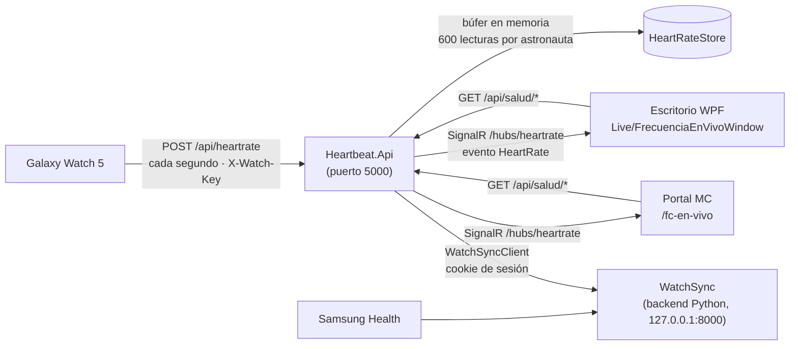

# Smartwatch: arquitectura y puesta en marcha

Épica [#52](https://github.com/AliaJimenez/HeartbeatBackend/issues/52) · Ticket [#155](https://github.com/AliaJimenez/HeartbeatBackend/issues/155)

Esta guía explica cómo llegan al sistema los datos del **Galaxy Watch 5** y de **Samsung Health**, cómo levantar el módulo en un equipo nuevo y qué límites tiene. Se descartó Google Health / OAuth (ver #53 y #54): el reloj habla directamente con nuestra API y Samsung Health se lee a través de WatchSync.

> **Datos simulados y no diagnóstico.** Heartbeat es una herramienta de apoyo a la decisión; no es un dispositivo médico y no diagnostica. Las lecturas del reloj son una demostración y no deben usarse como consejo médico.

## 1. Arquitectura

Hay dos caminos independientes: la **frecuencia cardíaca en vivo** (un dato por segundo) y los **datos diarios de Samsung Health** (resumen, FC histórica, sueño, actividad, presión).



### 1.1 FC en vivo (`src/Heartbeat.Api/Live/`)

1. El reloj envía `POST /api/heartrate` cada segundo con el encabezado `X-Watch-Key` y este cuerpo (contrato fijo del reloj):

   ```json
   { "bpm": 77, "measuredAt": "2026-11-15T16:00:00.123456Z", "source": "galaxy-watch-5" }
   ```

2. La API busca el hash SHA-256 de la clave en `WatchDevices` y obtiene el **astronauta dueño** del reloj. Sin clave o con una desconocida responde `401`; con `bpm` fuera de 25–250 responde `400`.
3. La lectura se guarda en el búfer en memoria de ese astronauta (últimas 600, unos 10 minutos) y se difunde por SignalR al grupo de ese astronauta.
4. Los clientes la reciben del hub `/hubs/heartrate` (evento `HeartRate`) o la piden por HTTP:
   - `GET /api/heartrate/latest` (`204` si aún no hay datos)
   - `GET /api/heartrate/recent?seconds=N` (1–600, por defecto 300)

**Quién ve qué.** Consultar y conectarse al hub exige token. Un tripulante ve **solo su reloj** (el astronauta sale del token, nunca de la petición; pedir otro da `403`). Mission Control con `vitals.view` elige astronauta con `?astronautId=` (obligatorio en estas rutas). En WebSockets el token viaja en `?access_token=`.

### 1.2 Datos de Samsung Health (`src/Heartbeat.Api/Salud/`)

La API reexpone, tal cual, lo que devuelve el backend Python **WatchSync**:

| Ruta de Heartbeat | Qué devuelve |
| --- | --- |
| `GET /api/salud/resumen?fecha=yyyy-MM-dd` | Resumen del día (hoy por defecto) |
| `GET /api/salud/fc?desde&hasta&resolucion` | FC histórica; `resolucion` = `raw`, `5m`, `1h` (defecto) o `1d` |
| `GET /api/salud/sueno?desde&hasta` | Sueño (últimos 7 días por defecto) |
| `GET /api/salud/actividad?desde&hasta` | Actividad diaria (últimos 7 días por defecto) |
| `GET /api/salud/presion?desde&hasta` | Presión arterial (últimos 7 días por defecto) |
| `GET /api/salud/estado` | Estado de la sincronización de WatchSync |

Todas exigen token y siguen la misma regla de acceso que la FC en vivo (con la diferencia de que MC sin `astronautId` usa la cuenta por defecto).

`WatchSyncClient` inicia sesión en WatchSync (la sesión es una cookie `session`) y, si una llamada devuelve `401`, vuelve a iniciar sesión y repite **una sola vez**. Errores hacia el cliente: `503` si WatchSync no responde; `400`, `404` y `422` se reenvían; cualquier otro código da `502`. La API nunca se cae por esto.

### 1.3 Quién consume qué

| Pantalla | Repositorio | Usa |
| --- | --- | --- |
| `Live/FrecuenciaEnVivoWindow` (escritorio) | HeartbeatFrontDesktop | `/hubs/heartrate`, `/api/heartrate/*` |
| `Salud/ResumenSaludWindow` (escritorio) | HeartbeatFrontDesktop | `/api/salud/*` |
| `/fc-en-vivo` y `/salud` (portal) | HeartbeatFrontWeb | lo mismo, desde el portal de Mission Control |

## 2. Puesta en marcha

### 2.1 WatchSync (backend Python)

WatchSync es un servicio **aparte** y **su código no está en este repositorio**. Heartbeat solo necesita que responda en `WatchSync:BaseUrl` (por defecto `http://127.0.0.1:8000/api/v1`) y que exista una cuenta con la que iniciar sesión.

En el equipo de la demo vive así (las rutas son las de ese equipo; ajústalas al tuyo):

- **Código:** carpeta `Nueva carpeta\backend`, una API FastAPI con Python 3.13 y su propio `.venv`.
- **Base de datos:** PostgreSQL 17 portátil en `D:\PostgreSQL\17`, con los datos en `D:\PostgreSQL\data17`. Escucha en `127.0.0.1:5433`. **No es un servicio de Windows**: hay que arrancarla a mano después de cada reinicio.
- **Configuración:** `backend\.env`, que no se versiona.

Desde PowerShell, en la carpeta `backend`:

```powershell
.\scripts\dev.ps1 pg-start   # arranca PostgreSQL (tras cada reinicio)
.\scripts\dev.ps1 migrate    # solo si hay migraciones nuevas
.\scripts\dev.ps1 api-red    # API en 0.0.0.0:8000 (el teléfono llega por Wi-Fi)
```

`api-red` escucha en todas las interfaces para que el teléfono (que sincroniza Samsung Health) llegue por Wi-Fi; `.\scripts\dev.ps1 api` escucha solo en este equipo (`127.0.0.1:8000`), suficiente si no hace falta el teléfono.

> **Ojo con las copias.** Puede haber más de una copia del backend en el equipo (por ejemplo una en `Downloads\Nueva carpeta\backend`). Todas usan la misma base de datos y funcionan igual, pero conviene saber cuál se está ejecutando y cuál se edita.

Sin WatchSync ni PostgreSQL en marcha, `/api/salud/*` responde `503` o `502`, pero la FC en vivo funciona igual.

### 2.2 Credenciales de WatchSync

La contraseña **no** va en `appsettings.json`; se guarda en user-secrets:

```bash
dotnet user-secrets set "WatchSync:Password" "<contraseña>" --project src/Heartbeat.Api
```

`appsettings.json` solo lleva `WatchSync:BaseUrl` y `WatchSync:Email` (por defecto `dev@example.com`). Se pueden asociar cuentas de WatchSync distintas a cada astronauta, con su `UserName` como clave:

```bash
dotnet user-secrets set "WatchSync:Accounts:a.rivera:Email" "ana@example.com" --project src/Heartbeat.Api
dotnet user-secrets set "WatchSync:Accounts:a.rivera:Password" "<contraseña>" --project src/Heartbeat.Api
```

Quien no tiene cuenta propia usa la de por defecto. Fuera de desarrollo, las mismas claves se pasan como variables de entorno (`WatchSync__Password`, `WatchSync__Accounts__a.rivera__Password`).

### 2.3 Arrancar la API con el puerto 5000 abierto

```bash
dotnet run --launch-profile http --project src/Heartbeat.Api
```

El perfil `http` escucha en `http://localhost:5027` y en `http://0.0.0.0:5000`; el reloj usa el **puerto 5000**. En Windows hay que permitirlo en el firewall (en el perfil de red privada), por ejemplo desde un PowerShell de administrador:

```powershell
New-NetFirewallRule -DisplayName "Heartbeat API 5000" -Direction Inbound -Protocol TCP -LocalPort 5000 -Action Allow -Profile Private
```

### 2.4 Registrar el reloj de un astronauta

Cada reloj tiene su propia clave y pertenece a un astronauta. Mission Control con permiso `crew.manage` lo registra:

```http
POST /api/mc/v1/watches
{ "deviceId": "galaxy-watch-5-ana", "astronautId": "<guid>", "label": "Reloj de Ana" }
```

La respuesta incluye la **clave en claro una sola vez**; en la base solo queda su hash SHA-256. Si se pierde o se filtra: `POST /api/mc/v1/watches/{id}/rotate-key` genera otra (la anterior deja de valer). También existen `GET /api/mc/v1/watches` (con `?astronautId=`) y `DELETE /api/mc/v1/watches/{id}`. Un `deviceId` repetido da `409`.

### 2.5 Configurar el reloj

El reloj debe enviar a una **URL fija** con la IP del equipo que corre la API en la red local, y con su clave:

```text
POST http://<IP-del-equipo>:5000/api/heartrate
X-Watch-Key: <clave del reloj>
```

La app del reloj («FC en vivo», Wear OS) vive en [AliaJimenez/HeartbeatWatch](https://github.com/AliaJimenez/HeartbeatWatch) (`android/wear`), junto con el script `scripts/registrar-reloj.ps1`, que hace el paso 2.4 y te da el comando para configurarlo. Resumen:

```bash
cd HeartbeatWatch/android && ./gradlew :wear:assembleDebug        # JDK 17
adb install -r wear/build/outputs/apk/debug/wear-debug.apk
adb shell am start -n com.watchsync.live/.LiveActivity --es url http://<IP-del-equipo>:5000/api/heartrate --es key <clave>
```

La app recuerda la URL y la clave; también se pueden fijar al compilar con `-PliveUrl=... -PwatchKey=...`.

**Una sola URL para todos.** El reloj envía a un único backend, así que una máquina hace de servidor y el resto se conecta a ella:

- **Misma red:** el reloj usa `http://<IP-del-equipo>:5000/api/heartrate`. Los demás apuntan su escritorio (`CrewApi__BaseUrl=http://<IP>:5000/`) y su portal (`MissionControlApi__BaseUrl=http://<IP>:5000/api/mc/v1/`) a esa IP; el puerto `5027` solo escucha en `localhost`. Conviene reservar la IP del equipo en el router. Las Wi-Fi públicas suelen aislar los dispositivos: usa la zona Wi-Fi de un teléfono.
- **Redes distintas, sin desplegar:** publica el puerto 5000 con una URL HTTPS fija (p. ej. `tailscale funnel 5000` → `https://<pc>.<tailnet>.ts.net`, o ngrok / Cloudflare Tunnel). El reloj usa `https://.../api/heartrate` directamente (no sigue redirecciones) y los frontends esa misma URL base. SignalR funciona por esos túneles.
- **Desplegado:** ver [DESPLIEGUE.md](DESPLIEGUE.md). Una sola instancia: el búfer de lecturas vive en memoria.

### 2.6 Probar sin reloj

```powershell
Invoke-RestMethod -Method Post -Uri http://localhost:5000/api/heartrate `
  -Headers @{ "X-Watch-Key" = "<clave>" } -ContentType 'application/json' `
  -Body '{"bpm":77,"measuredAt":"2026-11-15T16:00:00.123456Z","source":"prueba"}'
```

Con un token del astronauta dueño, `GET /api/heartrate/latest` debe devolver `bpm` = 77. Con `bpm` 400 la API responde `400`; sin clave, `401`. Con un token de crew o MC, `GET /api/salud/resumen` devuelve el resumen, o `503`/`502` si WatchSync o su base de datos están caídos.

## 3. Limitaciones

- **HTTP sin TLS en la red local.** El reloj llama por HTTP y no sigue redirecciones, por eso `/api/heartrate` y `/hubs/heartrate` quedan fuera de la redirección a HTTPS. La clave del reloj y las lecturas viajan sin cifrar por la red local: usar solo en una red de confianza. El resto de la API sí redirige a HTTPS.
- **WatchSync usa una cuenta por defecto y, opcionalmente, una por astronauta.** Sin cuenta propia configurada, todos los astronautas leen los datos de Samsung Health de la cuenta por defecto, es decir, de la misma persona.
- **Solo con enlace.** La FC en vivo necesita que el reloj, la API y el cliente estén conectados. El búfer vive en memoria: se pierde al reiniciar la API y solo conserva las últimas 600 lecturas por astronauta. No pasa por la sincronización de la app de escritorio, así que el modo offline-first de los check-ups **no cambia**: sin enlace la app sigue funcionando igual, solo que sin FC en vivo ni datos de Samsung Health.
- **Aún no se guarda como `Reading`.** Las lecturas del reloj no se convierten en lecturas del historial con origen `wearable` (ticket #55) ni se evalúan para alertar si la FC se mantiene en crítico (#153).
- **No es un dispositivo médico.** Ver el aviso al principio de esta guía y la [data card](DATA-CARD.md).
